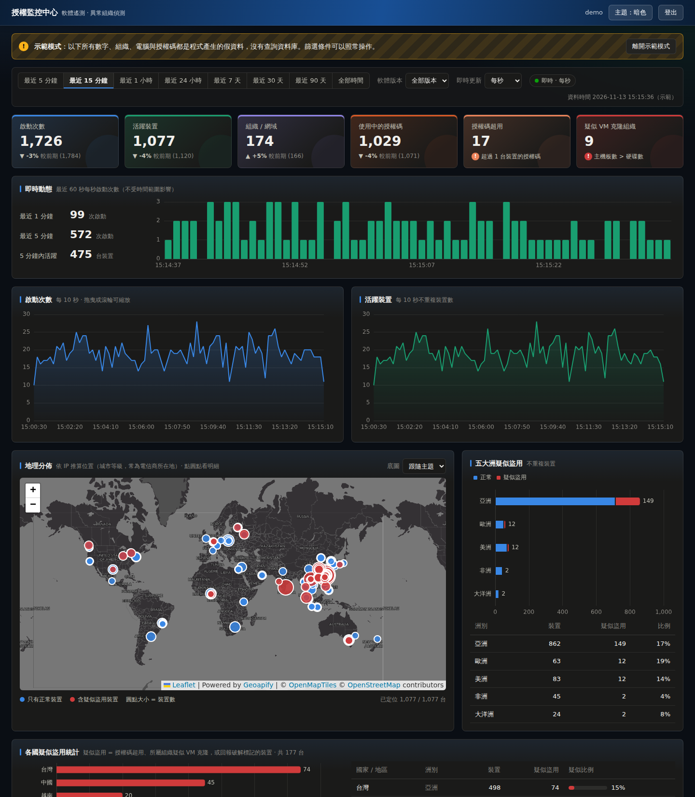
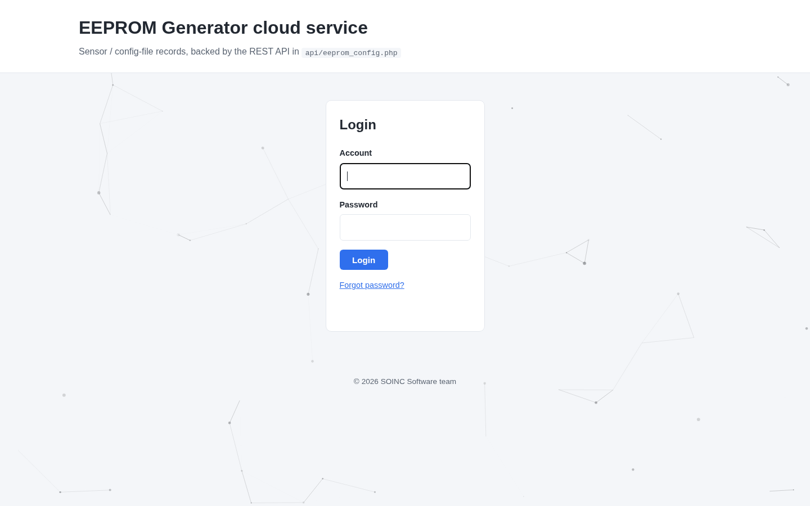
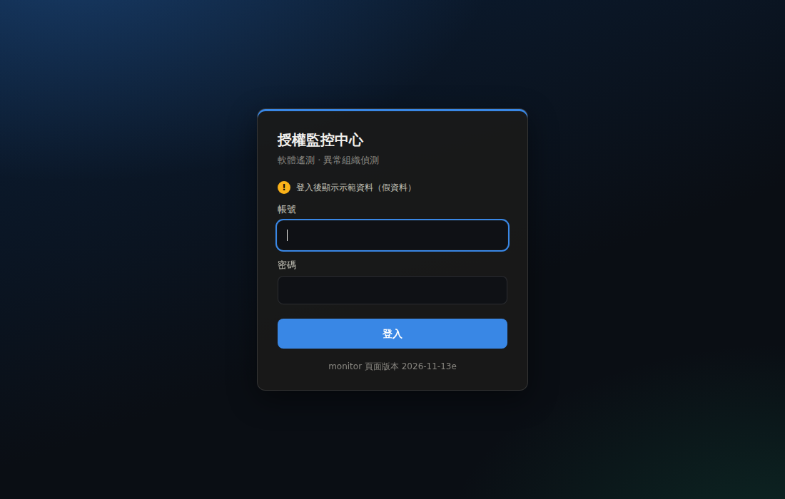

# EEPROM Generator Cloud Service

EEPROM 設定檔的雲端管理服務，加上桌面軟體的授權監控：

- **EEPROM Config**：用網頁管理 `eeprom_config` 資料表，並提供 REST API 給桌面工具（E2pRom_Generator、SOICamConfig）
  同步資料與查詢軟體更新。
- **授權監控中心**：桌面軟體每次啟動時回報遙測（`api/collect.php`），監控頁以地圖、圖表與排行找出疑似盜用的組織。

> 本分支 `feature/monitor-telemetry-security` 在 `main` 之上加入遙測、監控頁與安全強化，尚未合併回 `main`。

| 頁面 | 正式站網址 |
|---|---|
| EEPROM Config | <https://pend.soinc.com.tw/chamonix/index.html> |
| 授權監控中心 | <https://pend.soinc.com.tw/chamonix/monitor/index.php>（示範資料：`?demo=1`） |



> 截圖中的資料皆為範例：EEPROM 列表的檔名以 `SAMPLE_` 開頭；監控頁是示範模式產生的假資料。

---

## 畫面

### EEPROM Config

| 登入 | 設定檔列表 |
|---|---|
|  |  |

### 授權監控中心

| 登入（獨立帳號狀態） | 儀表板 |
|---|---|
|  |  |

## 功能

### EEPROM Config（`index.html`）

- **設定檔管理**：列表、搜尋、分頁、新增、編輯、刪除，以及把 `content` 下載成檔案。
- **固定值域**：`file_format`（INI / BIN）、`output_format`（AHD / YUV422）、`support_mode`（Master / Slave）
  以標準寫法儲存，網頁與桌面工具同步時不會因拼法不同而衝突。
- **帳號登入**：bcrypt 密碼雜湊、PHP session；另支援每次請求帶 `X-Account` / `X-Password` 標頭給工具使用。
- **忘記密碼**：寄出一次性重設連結 `index.html#reset=<token>`（token 只以 SHA-256 存在資料庫）。
- **桌面軟體更新**：`update.php` 回傳最新版本、下載網址、說明與 SHA-256。

### 遙測（`api/collect.php`）

- 桌面軟體啟動時以 JSON 回報 `machine_id`、電腦名稱、AD 網域、內網 IP、CPU／主機板／硬碟序號、OS、版本、授權碼。
- 免認證；每 IP 每分鐘上限、64 KB 上限、欄位型別與長度檢查；來源 IP 只信任連線位址。
- 公開 IP 向 ip-api.com 查詢 ISP、組織、國家、洲別與經緯度並快取；查詢失敗不影響回報。

### 授權監控中心（`monitor/index.php`）

- **獨立登入**：與 EEPROM Config 同一批帳號，但登入狀態分開；只有 `monitor_admins` 名單內的帳號能登入。
- **指標卡**：啟動次數、活躍裝置、組織數、授權碼數（含與前期比較）、授權碼超用、疑似 VM 克隆組織。
- **即時動態**：最近 60 秒每秒啟動次數、最近 1／5 分鐘啟動數、5 分鐘內活躍裝置。
- **趨勢與分布**：啟動與裝置趨勢、星期 × 小時熱力圖、組織／國家／版本／作業系統／架構排行。
- **地理分布**：Leaflet + Geoapify 地圖（圓點大小 = 裝置數、紅色 = 含疑似盜用），五大洲與各國疑似盜用統計。
- **排行與明細**：授權碼排行（超用、跨組織）、組織排行（疑似 VM 克隆、多機集中）、最新 50 筆事件、組織電腦明細。
- **時間範圍**：5 分鐘、15 分鐘、1 小時、24 小時、7／30／90 天、全部；**即時更新** 1～60 秒，不重新載入頁面。
- **示範模式**（`?demo=1`）：約 150 個組織、2,100 台電腦的假世界，資料每秒變動，不查資料庫。

疑似盜用的判定：授權碼使用台數超過上限、所屬組織主機板數多於硬碟數（同一硬碟映像複製）、或回報設定的破解標記。
遙測是客戶端自報的資料，標記只能當線索，不能當證據。

### 安全強化

- **登入次數限制**：同一帳號 15 分鐘內失敗 5 次、或同一 IP 失敗 20 次即暫時鎖定（回 429），三個登入入口都適用。
- **強制 HTTPS**：頁面 http 轉 https、帶密碼的 API 拒絕 http（桌面軟體用的 `collect.php`、`update.php` 除外）。
- **安全標頭**：`Content-Security-Policy`（監控頁以 nonce 放行內嵌腳本）、`X-Frame-Options`、`X-Content-Type-Options`、
  `Referrer-Policy`、`Permissions-Policy`；HSTS 可由設定開啟。
- `users` 表的舊明碼密碼欄位已移除。

## 技術架構

| 層 | 使用 |
|---|---|
| 前端 | 原生 HTML / CSS / JavaScript（無框架）；ECharts 6.1.0（本站）、Leaflet 1.9.4（unpkg + SRI）、particles.js、p5.js |
| 地圖圖磚 | Geoapify（`osm-bright-grey` / `dark-matter-brown`，可切換） |
| 後端 | PHP 7.4 以上 + PDO（prepared statements），無框架 |
| 資料庫 | MariaDB / MySQL（`eeprom_config`、`users`、`password_resets`、`telemetry_logs`、`ip_intel_cache`、`login_attempts`） |
| 寄信 | PHPMailer 6.10.0 |
| 伺服器 | Apache；只部署 `www/` 資料夾 |

## 目錄結構

```text
.
├── www/                        # 唯一要部署的資料夾（對應伺服器上的 /chamonix/）
│   ├── index.html              # EEPROM Config 網頁
│   ├── .htaccess               # 靜態檔的安全標頭（伺服器允許時才生效）
│   ├── assets/                 # CSS、JS（app.js 與 vendor/）
│   ├── api/
│   │   ├── bootstrap.php       # 共用：錯誤處理、讀設定、安全標頭、HTTPS、API key、資料庫
│   │   ├── eeprom_config.php   # eeprom_config 的 CRUD
│   │   ├── login.php / logout.php / session.php
│   │   ├── forgot_password.php / reset_password.php
│   │   ├── public_key.php      # 發 API key 給網頁（免認證）
│   │   ├── collect.php         # 遙測回報（免認證）
│   │   ├── update.php          # 桌面軟體更新資訊（免認證）
│   │   ├── config/             # config.sample.php（真正的 config.php 只放在伺服器）
│   │   └── lib/                # LoginThrottle、SecurityHeaders、SessionAuth、CredentialAuth、Database、Mailer...
│   ├── monitor/
│   │   ├── index.php           # 授權監控中心
│   │   ├── geo.php             # 地圖、洲別、國家統計規則
│   │   ├── demo_data.php       # 示範模式的假資料引擎
│   │   └── echarts.min.js
│   └── project/                # 桌面軟體安裝檔（release / debug）
├── sql/                        # 資料表結構與 migration（不部署）
├── tools/create_user.php       # 在本機產生帳號的 INSERT / UPDATE（只含密碼雜湊）
├── API_DOCUMENTATION.md / README_DEPLOY.md / CHANGELOG.md / TODO.md
└── docs/screenshots/           # README 用截圖
```

## 部署

完整步驟見 [README_DEPLOY.md](README_DEPLOY.md)，摘要：

1. **資料庫**：依 `sql/schema.sql` 建表，並執行：
   - `sql/migrate_2026-11-12_telemetry.sql`：`telemetry_logs`、`ip_intel_cache`
   - `sql/migrate_2026-11-13_ip_geo.sql`：IP 快取加入國碼、洲別、經緯度
   - `sql/migrate_2026-11-13_security.sql`：`login_attempts`；分步移除 `users.password`
2. **設定**：在伺服器上由 `config.sample.php` 建立 `config.php`，填入資料庫帳密、API key，並視需要加入：
   `monitor_admins`、`telemetry`、`geoapify`（地圖金鑰，記得限制網址）、`security`、`login_throttle`。
3. **帳號**：在本機執行 `php tools/create_user.php <帳號> <密碼> [email]`，把印出的 SQL 貼到 phpMyAdmin。
4. **打包上傳**：`tar -czf deploy.tar.gz -C www .`，解壓到伺服器的網站資料夾。
5. **驗證**：登入兩個頁面；送一筆測試遙測（PowerShell 範例在 README_DEPLOY.md）；確認監控頁底部顯示
   「伺服器偵測 HTTPS：是」後，再開啟 `security.force_https`。

## API 摘要

Base URL：`https://pend.soinc.com.tw/chamonix/api/`。完整說明見 [API_DOCUMENTATION.md](API_DOCUMENTATION.md)。

| 端點 | 方法 | 用途 | 認證 |
|---|---|---|---|
| `public_key.php` | GET | 取得 API key | 無 |
| `login.php` / `logout.php` / `session.php` | POST / POST / GET | 登入、登出、查登入狀態 | API key |
| `eeprom_config.php` | GET / POST | 列表、單筆、下載、新增、更新、刪除 | API key + 登入 |
| `forgot_password.php` / `reset_password.php` | POST | 忘記密碼、重設密碼 | API key |
| `collect.php` | POST | 遙測：一次軟體啟動 | 無（每 IP 限速） |
| `update.php` | GET | 桌面軟體更新資訊 | 無 |

- 帶 API key 的端點只接受 HTTPS；登入失敗太多次回 429 與 `Retry-After`。
- 更新與刪除用 `POST` 加 `?_method=PUT|DELETE`（這台主機會擋掉真正的 PUT / DELETE）。

## 文件

- [API_DOCUMENTATION.md](API_DOCUMENTATION.md)：每個端點的請求、回應與範例，含 `collect.php` 與監控頁參數
- [README_DEPLOY.md](README_DEPLOY.md)：資料庫、設定、打包、驗證，以及「Monitor dashboard」操作說明
- [CHANGELOG.md](CHANGELOG.md)：已完成的功能
- [TODO.md](TODO.md)：待辦事項（含監控與安全的後續工作）
