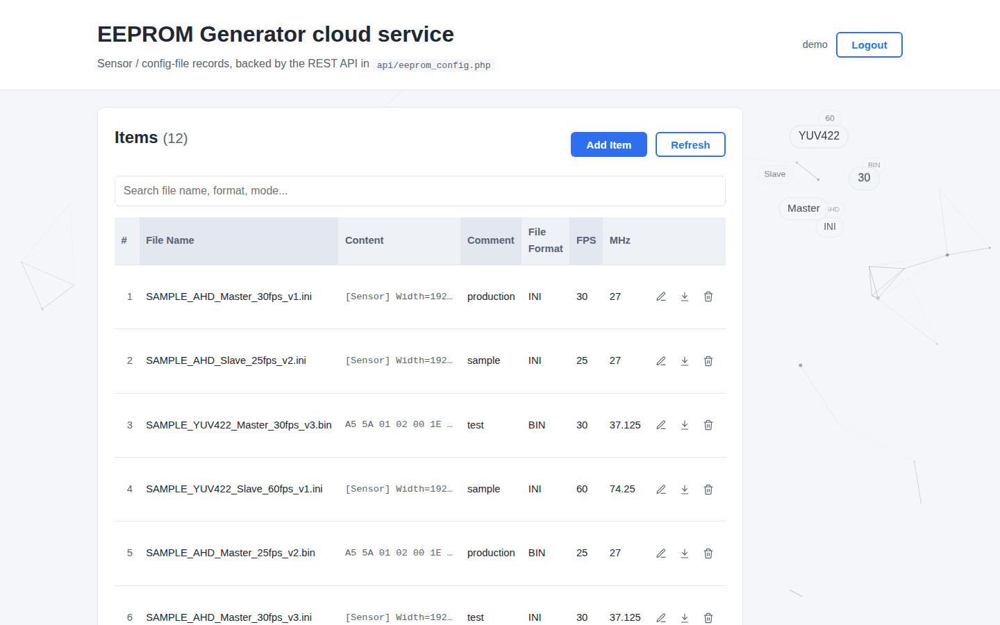

# EEPROM Generator Cloud Service

EEPROM 設定檔的雲端管理服務：用網頁管理 `eeprom_config` 資料表（新增、編輯、刪除、下載 INI / BIN 設定檔），
並提供 REST API 給桌面工具（E2pRom_Generator、SOICamConfig）同步資料與查詢軟體更新。

正式站：<https://pend.soinc.com.tw/chamonix/>



> 截圖中的資料皆為範例（檔名以 `SAMPLE_` 開頭），不是正式資料。

---

## 功能

- **設定檔管理**：列表、搜尋、分頁、新增、編輯、刪除，以及把 `content` 下載成檔案。
- **固定值域**：`file_format`（INI / BIN）、`output_format`（AHD / YUV422）、`support_mode`（Master / Slave）
  不分大小寫比對、以標準寫法儲存，讓網頁與桌面工具同步時不會因拼法不同而衝突。
- **帳號登入**：bcrypt 密碼雜湊、PHP session（`HttpOnly`、`SameSite=Lax`、HTTPS 時加 `Secure`）；
  另支援每次請求帶 `X-Account` / `X-Password` 標頭，給不保存 cookie 的工具使用。
- **忘記密碼**：寄出一次性重設連結（token 只以 SHA-256 存在資料庫，連結 30 分鐘內有效）。
- **桌面軟體更新**：`update.php` 依專案與通道（release / debug）回傳最新版本、下載網址、說明與 SHA-256。

## 畫面

| 登入 | 設定檔列表 |
|---|---|
|  |  |

## 技術架構

| 層 | 使用 |
|---|---|
| 前端 | 原生 HTML / CSS / JavaScript（無框架）；背景動畫 particles.js 2.0.0、p5.js 1.9.0（皆放在本站） |
| 後端 | PHP + PDO（prepared statements），無框架 |
| 資料庫 | MariaDB / MySQL（`eeprom_config`、`users`、`password_resets`） |
| 寄信 | PHPMailer 6.10.0（放在 `www/api/lib/phpmailer/`） |
| 伺服器 | Apache；只部署 `www/` 資料夾，不需要改伺服器設定 |

## 目錄結構

```text
.
├── www/                      # 唯一要部署的資料夾（對應伺服器上的 /chamonix/）
│   ├── index.html            # EEPROM Config 網頁
│   ├── assets/               # CSS、JS（app.js 與 vendor/）
│   ├── api/                  # REST API
│   │   ├── bootstrap.php     # 共用：錯誤處理、讀設定、API key 檢查、資料庫連線
│   │   ├── eeprom_config.php # eeprom_config 的 CRUD
│   │   ├── login.php / logout.php / session.php
│   │   ├── forgot_password.php / reset_password.php
│   │   ├── public_key.php    # 唯一免認證端點：發 API key 給網頁
│   │   ├── update.php        # 桌面軟體更新資訊（免認證）
│   │   ├── config/           # config.sample.php（真正的 config.php 只放在伺服器）
│   │   └── lib/              # Response、Auth、SessionAuth、CredentialAuth、Database、Mailer...
│   └── project/              # 桌面軟體安裝檔（release / debug）
├── sql/                      # 資料表結構與 migration（不部署）
├── tools/create_user.php     # 在本機產生帳號的 INSERT / UPDATE（只含密碼雜湊）
├── API_DOCUMENTATION.md      # API 完整說明
├── README_DEPLOY.md          # 部署說明
├── CHANGELOG.md / TODO.md
└── docs/screenshots/         # README 用截圖
```

## 部署

完整步驟見 [README_DEPLOY.md](README_DEPLOY.md)，摘要：

1. **資料庫**：依 `sql/schema.sql` 建立 `eeprom_config`、`users`；執行 `sql/migrate_*.sql`。
2. **設定**：在伺服器上把 `www/api/config/config.sample.php` 複製成 `config.php`，填入資料庫帳密與 API key
   （`php -r "echo bin2hex(random_bytes(32));"`）。`config.php` 永遠不進版本控制。
3. **帳號**：在本機執行 `php tools/create_user.php <帳號> <密碼> [email]`，把印出的 SQL 貼到 phpMyAdmin。
4. **打包上傳**：`tar -czf deploy.tar.gz -C www .`，解壓到伺服器的網站資料夾。
5. **驗證**：開啟首頁登入，新增／編輯／刪除一筆資料。

## API 摘要

Base URL：`https://pend.soinc.com.tw/chamonix/api/`，回應格式 `{"success": true, "data": ...}`。
完整說明見 [API_DOCUMENTATION.md](API_DOCUMENTATION.md)。

| 端點 | 方法 | 用途 | 認證 |
|---|---|---|---|
| `public_key.php` | GET | 取得 API key | 無 |
| `login.php` / `logout.php` / `session.php` | POST / POST / GET | 登入、登出、查登入狀態 | API key |
| `eeprom_config.php` | GET / POST | 列表、單筆、下載、新增、更新、刪除 | API key + 登入 |
| `forgot_password.php` / `reset_password.php` | POST | 忘記密碼、重設密碼 | API key |
| `update.php` | GET | 桌面軟體更新資訊 | 無 |

更新與刪除用 `POST` 加 `?_method=PUT|DELETE`（這台主機會擋掉真正的 PUT / DELETE）。

## 安全設計

- 資料庫帳密只在伺服器的 `config.php`，不回傳給瀏覽器、不寫進記錄；錯誤只回通用訊息，細節寫進 PHP 錯誤記錄。
- 所有 SQL 都用 prepared statements。
- API key 只用來擋掉沒載入網頁的自動化請求；真正的存取控制是帳號登入。
- 帳號不存在與密碼錯誤回同一句訊息，無法藉此列舉帳號。
- 忘記密碼的 token 放在網址的 `#` 之後，不會出現在伺服器記錄或 Referer 中。

## 文件

- [API_DOCUMENTATION.md](API_DOCUMENTATION.md)：每個端點的請求、回應與範例
- [README_DEPLOY.md](README_DEPLOY.md)：資料庫、設定、打包、驗證
- [CHANGELOG.md](CHANGELOG.md)：已完成的功能
- [TODO.md](TODO.md)：待辦事項
